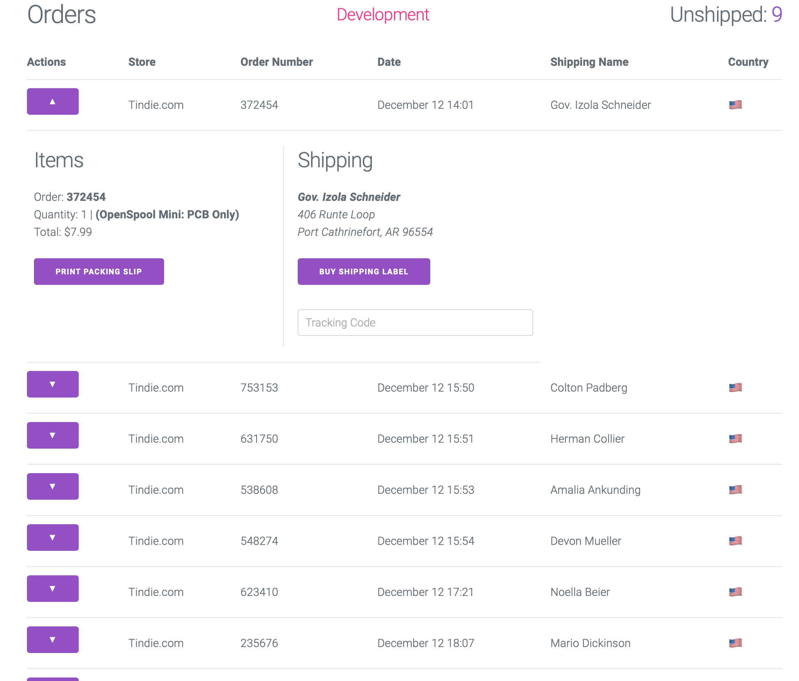

<p align=center>
    
</p>


# PackPoint

The shipping station software for Tindie / Etsy / Stripe / Easy Post


## Usage

Create a `.env` file with your settings. You can use the provided examples. 

`cp .env.sample .env`

Stripe support is optional and can pull orders from multiple Stripe stores/accounts at once - add a
`STRIPE_STORE_<id>_NAME` / `STRIPE_STORE_<id>_SECRET_KEY` / `STRIPE_STORE_<id>_EASYPOST_FROM_ADDRESS` trio per
store (see `.env.sample`). Orders are matched to Stripe Checkout Sessions that have collected a shipping
address; "shipped" status, tracking code, and label URL are written back to Stripe as metadata on the
PaymentIntent when you buy a label, so fulfillment state lives in Stripe rather than only in this app's session.

Each store ships from its own return address: Tindie orders use `TINDIE_EASYPOST_FROM_ADDRESS`, and each Stripe
store uses its own `STRIPE_STORE_<id>_EASYPOST_FROM_ADDRESS`. Both are EasyPost address IDs (`adr_...`) for
addresses already saved in your EasyPost account.

### Etsy setup

Etsy support is optional and, like Stripe, can pull orders from multiple Etsy shops/API keys at once - add a
`ETSY_STORE_<id>_NAME` / `SHOP_ID` / `API_KEY` / `ACCESS_TOKEN` / `REFRESH_TOKEN` group per shop (see
`.env.sample`).

1. Register an app at [etsy.com/developers/your-apps](https://www.etsy.com/developers/your-apps) to get an API
   key (Keystring). Add a callback URL to the app - `http://localhost:3003/callback` is a fine placeholder if you
   don't have one, it just needs to match what you pass to step 2.
2. Run `ruby bin/etsy_oauth API_KEY SHOP_ID` (your shop's numeric id, from Shop Manager > Settings > Options) and
   follow the prompts - it walks you through Etsy's OAuth login in a browser, then prints the
   `ETSY_STORE_<id>_*` lines to paste into `.env`. This is a one-time step per shop; PackPoint (see
   `ShippingApp::EtsyClient`) refreshes the access token on its own from then on and caches the rotated token
   pair in `cache/etsy_tokens/` so a restart doesn't need it either.
3. Pick a `RATE_SOURCE` for that shop:
   - `easypost` (default) - PackPoint rate-shops and buys the label the same way it does for Tindie/Stripe
     orders. Requires `ETSY_STORE_<id>_EASYPOST_FROM_ADDRESS`.
   - `etsy` - the shop buys its own postage directly on Etsy.com (Etsy's built-in USPS/UPS pricing). PackPoint
     shows the shipping price the buyer already paid instead of quoting/buying a label, and the order's kebab
     menu (⋮) offers "Mark as Shipped" - which submits your tracking number straight to Etsy - once you've
     bought and printed the label there.

### International shipping

International orders get their own panel (instead of a link out to
easypost.com): a carrier choice (USPS/FedEx/UPS/DHL, quoted the same way as
domestic - whichever have a rate for the shipment), an address check against
EasyPost/carrier data, and an editable customs form.

- **Carrier / rates**: the "Check Price" flow quotes all of
  `ShippingApp::ShippingService::QUOTED_CARRIERS`, DHL included - it just
  won't show a carrier that has no rate for the shipment (e.g. DHL not
  configured on your EasyPost account, or a service that doesn't reach that
  country). Requires a DHL Express carrier account connected in EasyPost if
  you want DHL rates at all.
- **Address verification**: expanding an international order's row checks
  the shipping address via EasyPost's address verification the first time,
  and shows the result as a banner. This is informational, not a gate -
  foreign addresses frequently fail strict verification (missing region
  codes, transliteration, limited per-country coverage) even when they're
  perfectly deliverable, so a failed check just means "double check this
  one," not "don't ship it."
- **Customs**: EasyPost requires a customs form for international labels.
  Each product's HS tariff code / country of origin / customs description
  is pre-filled where possible and always editable in the panel before
  buying:
  - **Stripe** products carry this as native Product metadata - add
    `hs_tariff_number`, `customs_origin_country`, `customs_description`,
    and (optionally) `customs_value` metadata keys on the Product in the
    Stripe dashboard.
  - **Tindie** and **Etsy** (for shops with `RATE_SOURCE=easypost` - see
    "Etsy setup" above) have no per-product customs fields in their APIs
    either, so both fall back to the same SKU-keyed
    [`config/customs_catalog.yml`](config/customs_catalog.yml) - see that
    file for the format. A product with no catalog entry just shows up with
    blank, required fields in the panel rather than silently shipping with
    an empty customs form. Etsy shops using `RATE_SOURCE=etsy` don't need
    this at all, since PackPoint never buys a label for them - Etsy's own
    checkout handles customs for labels bought on Etsy.com.
  - `CUSTOMS_SIGNER_NAME` (optional, see `.env.sample`) sets who certifies
    the customs form; defaults to the shipping store's return address name.

Then start the server
`rackup`

localhost:9292

## Development
```
APP_ENV=development rackup
```


## Production
```
APP_ENV=production RACK_ENV=production bundle exec rackup --host 0.0.0.0
```

## Production Docker/Podman

```bash
podman build -t spuder/packpoint . 
podman run  --env-file .env -e APP_ENV=production -e RACK_ENV=production -p 9292:9292 localhost/spuder/packpoint:latest
```

## Example
This example uses Faker to generate dummy addresses and usernames. 

